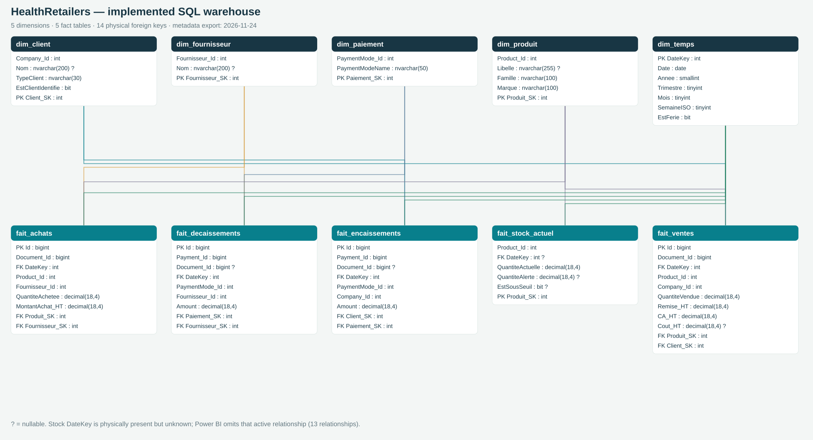

# Implemented warehouse diagram

This branch documents the actual SQL Server warehouse, not the older 4-dimension/3-fact or 7-dimension/6-fact diagrams.

`warehouse.mmd` is the editable Mermaid source. `schema.json` records SQL metadata and row counts. `DATA_DICTIONARY.md` lists column types, nullability and keys. `physical_schema.sql` creates the physical tables/keys in an empty database; use the `sql-server` and `ssis` branches for the full preparation/loading implementation.

Five dimensions: client, supplier, payment method, product and calendar. Five facts: sales, purchases, current stock, customer receipts and supplier disbursements. Business IDs remain available alongside surrogate keys.

There are 14 physical SQL foreign keys. The Power BI model activates 13 relationships: current stock has no known snapshot date, so its physical DateKey relationship is not used for time filtering. Payment documents are not linked directly to sales/purchase facts with a many-to-many relationship; DAX settlement measures apply document selections explicitly.

The calendar has 730 days; loaded real transactions end on 2025-04-30. No separate SSAS cube is included or claimed. Earlier diagram drafts are deliberately excluded.
